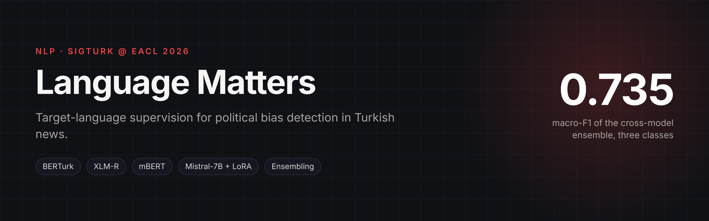
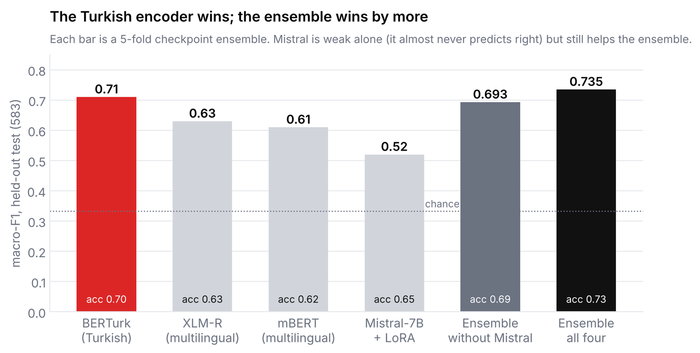
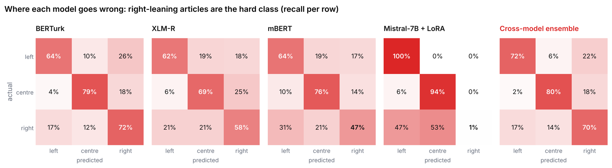
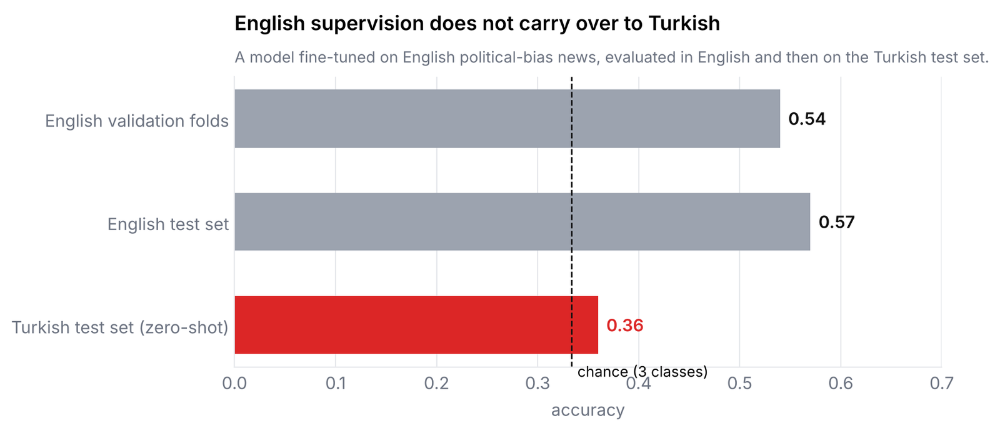
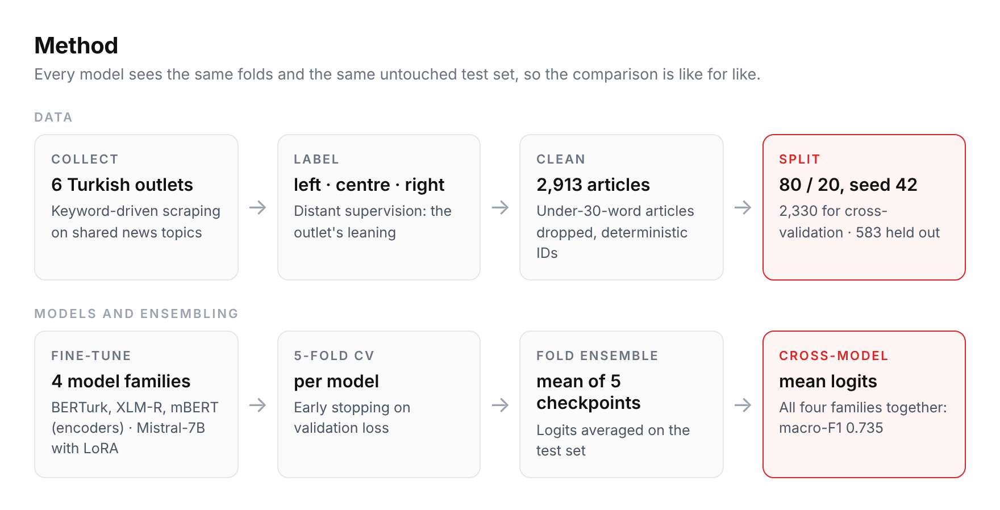

<p align="center"></p>

# Language Matters: Target-Language Supervision for Political Bias Detection in Turkish News

Fine-tuning and evaluation code for the paper

> **Language Matters: Target-Language Supervision for Political Bias Detection in Turkish News**
> Umut Ozbagriacik, Haim Dubossarsky · SIGTURK, EACL Workshop

Can a model tell whether a Turkish news article comes from a left, centre or right-leaning outlet,
and does it matter which language the model was trained in? This repository compares Turkish
monolingual, multilingual and decoder-based models on a three-class political-bias task, with
fold-level and cross-model ensembling.

**Notebooks:**
- [`Transformer-Based Bias Classifier.ipynb`](Transformer-Based%20Bias%20Classifier.ipynb): Turkish models, fold and cross-model ensembles
- [`cross_lingual_transfer.ipynb`](cross_lingual_transfer.ipynb): English supervision evaluated zero-shot on Turkish

---

## Headline results

Held-out test set of 583 articles; every model is trained with stratified 5-fold cross-validation and
its five fold checkpoints are averaged at test time.

| Model | Checkpoint | Accuracy | Macro-F1 | Zero-shot baseline (acc.) |
|---|---|---|---|---|
| **BERTurk** (5-fold ensemble) | `dbmdz/bert-base-turkish-uncased` | **0.70** | **0.71** | 0.29 |
| XLM-RoBERTa (5-fold ensemble) | `akdeniz27/xlm-roberta-base-turkish-ner` | 0.63 | 0.63 | 0.28 |
| mBERT (5-fold ensemble) | `bert-base-multilingual-cased` | 0.62 | 0.61 | 0.34 |
| Mistral-7B + LoRA (5-fold ensemble) | `malhajar/Mistral-7B-Instruct-v0.2-turkish` | 0.65 | 0.52 | 0.33 |
| **Cross-model ensemble** (all four, mean logits) | | **0.732** | **0.735** | |
| Cross-model ensemble without Mistral | | 0.691 | 0.693 | |

<p align="center"></p>

What the numbers say:

- **Target-language pre-training wins.** The Turkish monolingual encoder beats both multilingual
  encoders by 8 to 10 macro-F1 points on the same folds and test set.
- **A 7B decoder is not automatically better.** LoRA-tuned Mistral reaches 0.65 accuracy but almost
  never predicts *right* (recall 0.01), so its macro-F1 is only 0.52. Its left and centre logits
  still add complementary signal, lifting the cross-model ensemble from 0.693 to 0.735 macro-F1.
- **Right-leaning articles are the hardest class** for every model (BERTurk F1 0.66, XLM-R 0.58,
  mBERT 0.53).

  <p align="center"></p>
- **English supervision does not transfer.** A model fine-tuned on English political-bias news
  reaches 0.54 accuracy on English validation folds and 0.57 on an English test set, but only
  **0.36 accuracy** on the Turkish test set, barely above chance for three classes (see `cross_lingual_transfer.ipynb`). That
  gap is the "language matters" result.

  <p align="center"></p>

## Data

Articles were collected from six Turkish outlets with keyword-driven scraping on shared news
topics, so that outlets are compared on the same stories:

| Label | Outlets |
|---|---|
| left | BirGün, Sözcü |
| centre | Habertürk, Euronews (Turkish) |
| right | Milliyet, Diriliş Postası |

Labels are inherited from the outlet (distant supervision). Articles under 30 words are dropped and
every article receives a deterministic ID. After cleaning: **2,913 articles**, split 80/20
(stratified, seed 42) into 2,330 for cross-validation and 583 for the held-out test.

**The articles are not included in this repository** because of copyright. The notebook expects a
CSV with `Source`, `Title`, `URL`, `Content` and `search_keyword` columns.

## Method

<p align="center"></p>

<details>
<summary>Same flow as a text diagram</summary>

```
raw articles ─► clean + outlet labels ─► stratified 80/20 split
                                           │
              ┌────────────────────────────┴───────────────┐
              ▼                                            ▼
     5-fold CV on the 80%                          held-out 20% test
     per model, early stopping                            │
              │                                            │
              └──► 5 fold checkpoints ──► mean logits ─────┤  fold-level ensemble
                                                           │
           BERTurk · XLM-R · mBERT · Mistral-LoRA ─────────┤  mean logits across models
                                                           ▼
                                     accuracy · precision · recall · macro-F1 · confusion matrices
```

</details>

- **Encoders:** 3-class sequence classification, max length 128, batch 16, up to 20 epochs with
  early stopping on validation loss.
- **Mistral-7B:** LoRA adapters via PEFT, max length 256, learning rate 3e-4, effective batch 16,
  TF32 on A100.
- **Baselines:** every architecture is also evaluated with no fine-tuning (randomly initialised
  classification head) to show how much the task-specific supervision contributes.
- **Ensembling:** soft voting by averaging logits, first across folds and then across model
  families. Per-model votes are saved for error analysis.

## Running it

A CUDA GPU is required; the Mistral section needs an A100-class card. The notebook was run on
Google Colab.

```bash
pip install torch transformers datasets evaluate peft scikit-learn pandas numpy seaborn matplotlib
jupyter notebook "Transformer-Based Bias Classifier.ipynb"
```

Place your preprocessed CSV next to the notebook (see **Data**), then run the sections in order:
preprocessing and split, each model's 5-fold training, then the cross-model ensemble, which reads
the saved `logits_*.npy` files.

## Limitations

- Outlet-level labels are a proxy: an individual article from a left-leaning outlet is not
  necessarily left-leaning, so models partly learn outlet style.
- Six outlets and a few thousand articles; results may not generalise to other sources or periods.
- Input is truncated to 128 tokens for encoders and 256 for Mistral, so long articles are judged on
  their opening.

## Citation

```bibtex
@inproceedings{ozbagriacik-dubossarsky-language-matters,
  title     = {Language Matters: Target-Language Supervision for Political Bias Detection in Turkish News},
  author    = {Ozbagriacik, Umut and Dubossarsky, Haim},
  booktitle = {Proceedings of the SIGTURK Workshop at EACL},
  year      = {2026}
}
```
